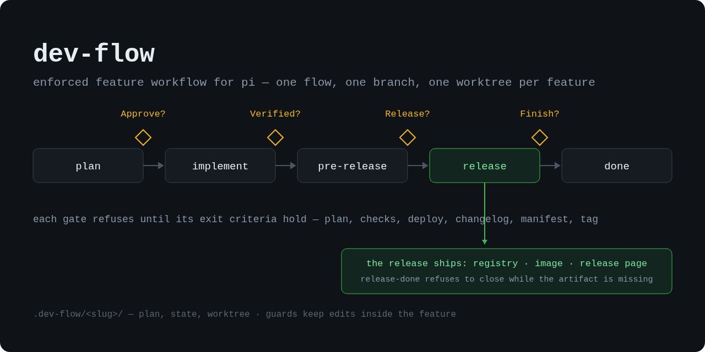

# dev-flow



A feature workflow for [Pi](https://pi.dev) that the agent can't skip. You describe a feature, the
agent builds it, and **the harness, not the agent, decides when a stage is done.** Each feature goes
`plan → implement → pre-release → release → done`, and you answer one question at each checkpoint.

- **Plan first.** The agent writes a spec and can't touch code until you approve it.
- **Real gates.** Each stage ends in a check: tests pass, the app deploys and is healthy, the
  changelog and version agree, the tag is on the remote.
- **Clean git.** Each feature gets its own worktree and branch. Nothing lands on main until release.
- **Parallel features.** One Pi session per feature, as many at once as you like.
- **It learns.** When something gets in the agent's way, it leaves you a note so you can fix your
  setup.

## Install

```bash
pi install npm:pi-dev-flow                        # from npm
pi install git:github.com/dmarchevsky/pi-dev-flow # or from git (pin with @vX.Y.Z)
```

Then run **`/flow init`** once in each project. It reads your repo (branch, forge, package manager,
test/build commands, version file, CI) and writes **`.dev-flow/project.md`**: your playbook. Each
question shows what it detected, so "keep these" usually answers it. It also installs a `pre-commit`
hook that blocks direct commits to main.

dev-flow does nothing in a repo until you run `/flow init`. Run it again later to check your
playbook for drift.

**Updating:** `pi update --extensions`, then `/reload` in running sessions. A running session keeps
the code it started with, and `flow version` tells you when it's behind.

## How it works

Ask for a feature in plain words, for example *"sessions expire silently, add sliding renewal and
a test"*. It becomes the feature `session-renewal`:

```
        you ask for a feature
                 │
        ┌────────▼────────┐
        │      plan       │  spec (+ mockups) in .dev-flow/<slug>/plan/
        └────────┬────────┘
         Approve?
        ┌────────▼────────┐
        │    implement    │  code + tests, in the feature's own worktree
        └────────┬────────┘
        Verified?  · checks green, app deployed and healthy
        ┌────────▼────────┐
        │   pre-release   │  review, docs, changelog, version bump
        └────────┬────────┘
          Release?  · usually answers itself when only release prep changed
        ┌────────▼────────┐
        │     release     │  PR → merge → tag → release notes
        └────────┬────────┘
           Finish?
        ┌────────▼────────┐
        │      done       │  worktree, branch and feature folder removed
        └─────────────────┘
```

| Stage | The agent | You answer |
|---|---|---|
| **plan** | reads the code, asks questions, writes `plan/plan.md` | **Approve?** — build it |
| **implement** | works on `feat/<slug>`, commits in small steps, gets the checks green | **Verified?** — you tried it; also pick patch / minor / major, or merge unreleased |
| **pre-release** | reviews, fixes, updates docs and changelog, bumps the version | **Release?** — only asked if something beyond release prep changed |
| **release** | opens the PR, merges, tags, publishes release notes | **Finish?** — clean up |

### Your answers

- **yes**, or **no** with a reason. The agent fixes it and asks again.
- **yolo**: yes to this question and to all the remaining ones. Every check still runs. You can add
  wishes: *"yolo, patch bump"*.
- **merge unreleased**: merge with a changelog entry, but no version bump or tag. The next release
  picks it up.

For small work the agent may suggest a lighter **mode**: `--patch` for a quick fix with no written
plan, or `--docs` for docs-only changes with no build checks.

You never need to type `flow` commands. `/flow …` is there as a manual override when a session gets
stuck. See the [gate reference](https://github.com/dmarchevsky/pi-dev-flow/blob/main/docs/gates.md).

## What is enforced

While a feature is in flight, every tool call goes through a guard:

- no commit, merge or push to main before the release stage (plus a git hook for work outside Pi);
- during plan, the agent can only write in its own feature folder; after that, only in its own
  worktree;
- outside a flow, the agent can't edit source at all;
- flow state and your playbook are off limits to the agent, so gates can't be faked;
- your own `deny` / `confirm` / `protect` / `forbid` rules run on every command and path;
- shell calls without a timeout get a sensible default, so nothing hangs forever.

More detail, and what this deliberately is *not*, is in
[Guardrails](https://github.com/dmarchevsky/pi-dev-flow/blob/main/docs/guardrails.md).

## Also built in

- **Reflections.** When something costs the agent a step, it notes it in
  `.dev-flow/reflections.md`. At finish, a separate reviewer reads the session and suggests what to
  keep. [More](https://github.com/dmarchevsky/pi-dev-flow/blob/main/docs/reflections.md)
- **`/flow-review`** reviews a change against its plan. **`/flow-audit`** audits the whole repo.
  **`/flow-simplify`** removes dead and duplicated code, one verified commit at a time.
- **`flow_stage` workers.** The agent can hand big chunks of work, or a second-opinion review, to a
  fresh Pi session.
- **A roadmap.** `.dev-flow/roadmap.md` is a backlog of future features. `flow start <slug>` can
  pick one up.

## Where things live

```
.dev-flow/
  project.md            your playbook (the only committed file here)
  reflections.md        the agent's notes to you
  roadmap.md            your backlog of future features
  <slug>/
    plan/plan.md        the spec you approve
    plan/mockups/       mockups and screenshots (UI features)
    worktree/           the feature's git worktree
    state.json          stage, approvals, checks (the agent can't write it)
```

## Docs

| Doc | What's in it |
|---|---|
| [Playbook](https://github.com/dmarchevsky/pi-dev-flow/blob/main/docs/playbook.md) | writing `project.md`: checks, checklists, guard rules, `flow init` |
| [Gates](https://github.com/dmarchevsky/pi-dev-flow/blob/main/docs/gates.md) | every gate, its flags, and why it refuses |
| [Guardrails](https://github.com/dmarchevsky/pi-dev-flow/blob/main/docs/guardrails.md) | everything enforced, and the deliberate limits |
| [Reflections](https://github.com/dmarchevsky/pi-dev-flow/blob/main/docs/reflections.md) | the agent's notes, the closing review, nudges |
| [Concurrency](https://github.com/dmarchevsky/pi-dev-flow/blob/main/docs/concurrency.md) | several sessions in one repo |
| [Headless](https://github.com/dmarchevsky/pi-dev-flow/blob/main/docs/headless.md) | driving dev-flow from a bot, web UI or queue |
| [Development](https://github.com/dmarchevsky/pi-dev-flow/blob/main/docs/development.md) | working on dev-flow itself |

## Credits

The review skills adapt ideas from ponytail, obra/superpowers and pi-development-system (MIT).
`/flow-simplify` adapts goal-sloc (MIT), addyosmani/agent-skills (MIT) and Anthropic's
code-simplifier plugin (Apache-2.0). Details are in each skill file. dev-flow itself is MIT.
