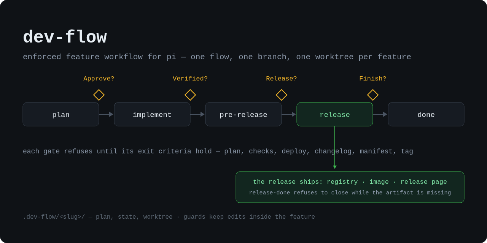

# dev-flow



An enforced feature workflow for [Pi](https://pi.dev), shipped as a pi package. You say what you
want; an agent builds it; **the harness — not the agent's good manners — decides whether a stage
may advance.** One feature at a time, five stages, and four questions asked of you —
`plan → implement → pre-release → release → done`, mapped out under [How you work it](#how-you-work-it).

## The idea

**Every feature starts as a spec.** `flow start <slug>` opens a feature: a folder under
`.dev-flow/<slug>/` where the agent researches and writes a plan — problem, approach, files to
touch, test strategy, risks — plus rendered screenshots for anything user-visible. Until you approve
it, the agent cannot edit code anywhere else in the repo. That is the whole "does it actually plan?"
question, answered by the harness instead of by trust.

**A bound session is self-identifying.** `flow start` (and `flow use`) renames the Pi session after
the flow slug, so the session picker always tells you which feature each session holds.

**Stages end in gates, not vibes.** Each stage has one exit gate that refuses until its criteria
hold: your plan file exists; every command your playbook names as a check passes; the app really
starts, with real data, and answers a health probe **after** a real deploy; changelog and version
manifest agree and the version is ahead of the last tag; the release is tagged and on the remote.
Gates read state that the agent is blocked from writing, so a step cannot be quietly skipped — and
each gate asks you exactly **one** question.

The flow itself ships with the plugin; a project carries only a `.dev-flow/` folder — state files,
plans and worktrees, nothing the plugin needs to run.

**Git stays clean by construction.** Nothing commits to the default branch while a feature is in
flight: work happens in its own git worktree and branch (`feat/<slug>`), so your checkout keeps
moving while a feature is under way. Publishing has one order — PR → merge → annotated tag → forge
release — and only in the release stage does dev-flow let git touch main again. A `pre-commit` hook
covers commits made outside Pi.

**Many features at once.** One Pi session = one feature = one worktree, and a repo can host as many
as you want in parallel. A write inside worktree X is judged by X's stage whoever made it, so
sessions cannot dirty each other's branches or borrow each other's approvals. [More here.](docs/concurrency.md)

**It learns from friction.** Every time the agent hits something that cost it a step — a playbook
command that no longer exists, a guard that refused the wrong thing, a gate that forced a detour — it
writes the observation down in `.dev-flow/reflections.md` instead of just working around it. Those
notes are advisory and never gate anything, but they are how your playbook stops drifting: you review
them with `flow doctor` and decide what to fix. [More here.](docs/playbook.md)

## Install

```bash
pi install npm:pi-dev-flow                        # a published release
pi install git:github.com/dmarchevsky/pi-dev-flow # or from git — pin a ref with @v0.49.1
pi install ./pi-dev-flow                          # or a local checkout
```

Later releases arrive with `pi update --extensions` (an npm install reconciles to the newest version);
then `/reload` — a running session keeps the code it loaded at startup. Two sources at once (a project
`git:` pin beside the global `npm:` package) load two copies — pi dedupes extensions by path, not by
package — so keep the one you actually update from. **The newest copy judges alone:** every copy's
guard hooks check which registered version is highest, and a stale duplicate answers nothing — the
most in-package removal can be, because Node cannot unload a loaded module and pi cannot unregister
its hooks. Only a host restart drops stale code; `/reload` re-binds session state, it never swaps
code. `flow version` lists every dev-flow copy registered in the process and names the copy serving
the call, and the on-disk session claim keeps the guard of a copy that never served
a flow call attributing your commands correctly.

Until `flow init` writes the playbook (`.dev-flow/project.md`), dev-flow says nothing in a repo — no
injections, no guards, no footer: the playbook is the opt-in. A stray `.dev-flow/` without it keeps
the folder dormant.

Then, once per project repo, `/flow init`. It reads the repo (default branch and forge from git,
package manager, test/build/run conventions, version manifest) and writes **`.dev-flow/project.md`
— your playbook**: the commands that count as checks, the manual checklist, the version and tag
convention, how a merged PR lands (`merge = squash | merge | rebase`), and any hard safety rules of your
own. It asks about everything detection could not
decide (self-hosted forge? Docker artifacts? what "healthy" means?) and installs a `pre-commit` hook
that blocks direct main commits. Run `/flow init` again later and it becomes a **doctor**: drift in
your playbook, dead commands, config problems — it never rewrites your hand edits without asking.
The flow is completely inert in repos with no `.dev-flow/`.

→ [The playbook](docs/playbook.md) — what goes in `project.md`, the three tiers, your own guard rules.

## How you work it

You are not a command runner. You ask for a feature and then answer four words — say *"sessions
expire silently, add sliding renewal and a test"* and it becomes the feature `session-renewal`,
walking five stages with a gate between each:

```
        you ask for a feature
                 │
        ┌────────▼────────┐
        │      plan       │  spec (+ mockups) in .dev-flow/<slug>/plan/
        └────────┬────────┘
         Approve?  · refuses without the written plan (and renders for UI work)
        ┌────────▼────────┐
        │    implement    │  code + tests, only inside the feature worktree
        └────────┬────────┘
        Verified?  · refuses until checks are green and the deployed app is healthy
        ┌────────▼────────┐
        │   pre-release   │  review, docs, changelog entry, version bump
        └────────┬────────┘
          Release?  · refuses unless the version passes the last tag and the changelog agrees
        ┌────────▼────────┐
        │     release     │  PR → merge → annotated tag → release notes
        └────────┬────────┘
           Finish?  · refuses until the release is recorded and main is clean and pushed
        ┌────────▼────────┐
        │      done       │  worktree, branch and feature folder removed
        └─────────────────┘
```

| Stage | What the agent does | It asks you |
|---|---|---|
| **plan** | reads the code, asks its clarifying questions, writes the spec to `.dev-flow/session-renewal/plan/plan.md` | **Approve?** — the plan is right, build it |
| **implement** | works in a fresh worktree on `feat/session-renewal`, commits in small steps, runs your `test` command to green, walks the manual checks with you | **Verified?** — after you used it running |
| **pre-release** | review and fixes, docs, changelog, version bump, checks re-run; shows the PR summary and the version it means to tag | **Release?** — ship it |
| **release** | PR → merge → annotated tag → release notes; only here may git touch main | **Finish?** — clean up, we're done |
| **done** | removes the worktree, branch and `.dev-flow/session-renewal/` | — |

Four answers from you; everything between them was the agent's problem and your playbook's gates. If
the feature grows mid-flight it is folded into this one (the plan gains an `Added mid-stage:` line and
checks re-run); a *different* problem waits for the next flow — one feature, one plan, one PR.

Your answers at a checkpoint:

- **yes** — or **no**, with the reason. The agent fixes it and asks again; that loop is free.
- **yolo** — answers this checkpoint *and* pre-confirms the rest, so the remaining gates run back to
  back with every check still enforced. Attach your wishes to the word: *"yolo, patch bump"*,
  *"yolo, no tag"*.
- **no version this time** (at Release?) — merge and changelog land, no bump or tag; the next
  versioned release folds your `Unreleased` entry under its heading.

Two things you grant rather than run: a **mode** when the agent proposes one (`normal` is the
default; `--patch` for a small change you intend to ship now, `--docs` for docs-only work — both skip
the written plan), and a **`/reload`** whenever dev-flow itself was updated — a running session keeps
the code it loaded at startup, and `flow version` tells you when it is behind. Updating or installing
the plugin, and running git outside Pi when one of your `confirm` rules fires with no UI to ask you,
are the only things dev-flow cannot do for you.

Nothing here trusts the agent in either direction: a checkpoint gate refuses if you never answered
(its refusal begins `NEEDS-OPERATOR Approve?`), and the agent is told never to ask *you* to type a
`flow` command. `/flow …` is your manual override — for when the session is stuck, wrong, or
claiming a gate result it never produced. → [Gate reference](docs/gates.md)

### Reflections: the agent's notes to you

When something costs the agent a step — a playbook command that stopped existing, a guard that
refused the wrong thing, a gate that forced a detour, a rough edge in dev-flow itself — it does not
just work around it. It parks a one-line note in `.dev-flow/reflections.md`, under **playbook**
(something about your project) or **plugin** (something about dev-flow) — the agent says which with
`flow reflect --playbook|--plugin "<note>"`, and a note queued without a flag lands on a keyword
guess the printed line explains (`flow reflect list` numbers the queue, `flow reflect move <n>
--plugin` re-files one). The open count surfaces in
`flow status` and in the agent's stage context (`↻ 2 reflection(s) open`).

With a GitHub remote, `flow doctor` and `flow reflect list` also **fold in the open GitHub issues**
— external submissions land on GitHub while the queue lives in `reflections.md`, so both surfaces
show one deduplicated view: a local item an open issue already covers carries `⟷ gh#120`, the rest
list below as upstream rows, and a near-duplicate is flagged (`~ gh#NNN may duplicate`) but never
auto-merged. The fold is display-only — upstream items close on GitHub, local items check off in
the file, never both. No GitHub remote shows nothing; missing or failing `gh` is one skip line, and
`DEV_FLOW_NO_ISSUES=1` turns the fold off.

They never gate anything, and the fix is never the agent's call alone. You ask it to go through them
— usually with `flow doctor`, which reviews each open item and routes it: a playbook item becomes a
small docs flow that edits `project.md` through the flow (so the change is committed and reviewed like
any other), a dev-flow item goes upstream as an issue. At the end of a session the agent does the same
review over the whole exchange before `Finish?`, so friction it noticed but never filed shows up too.
Fold, fix or drop them — but leaving them is the one option that lets the same friction come back next
feature.

### Reviews and senior discipline, built in

No companion plugin to install: dev-flow ships its own review skills. **`/flow-review`**
reviews a change — by default the bound flow's branch diff against the default branch, plus
uncommitted work — read against its `plan/plan.md` and its callers, not just the diff: every
finding needs a concrete triggering case (refuted findings are dropped), grouped Must fix /
Should fix / Nice to have, ending in a verdict and an honest `Not checked:` line. It is the
pre-release review step (`release.review` in `project.md` stays yours to set). **`/flow-audit`**
audits the whole repo in the same style: map first, judge against the load the project actually
expects, at most 20 ranked findings, changes nothing. The operative sibling **`/flow-simplify`**
makes the cuts audit and review only name: dead code, no-op subsystems, duplication,
speculative layers — removed in a risk-ascending order, one verified commit per cut, green
tests as contract, and a structural-vs-cheap self-audit so the diff shrank because the system
got smaller, not because comments got deleted. And while a flow writes code, the
implement stage injects a compact senior-discipline guidance — smallest complete change, no
speculative abstraction, finish what your change breaks, a failing-first test for risky logic —
your playbook's `prose.implement` replaces it wholesale whenever you write your own. (The review
rules adapt ponytail, obra/superpowers and pi-development-system — all MIT, credited in the
skill files; `/flow-simplify` adapts goal-sloc (MIT), addyosmani/agent-skills (MIT) and
Anthropic's code-simplifier plugin (Apache-2.0).)

## The playbook the agent always has

Pi lists a skill's name and description and loads the file only if the model chooses to read it —
and a session that never read the playbook is the one that guesses at a gate, then argues with the
guard. So dev-flow injects what must never be missing: the ground rules of `skills/dev-flow/SKILL.md`
(the flow tool is the only invocation, checkpoints are words in chat, binds are explicit, the
playbook and state files are read-only) land in the session once, roughly a thousand tokens, and a
compaction that summarizes them away brings them back exactly once. The per-stage detail — mockup harness,
release sequence, reflection protocol — stays on disk, and each stage's turn names the one file to
read. Nothing to configure; reloads, resumed and forked sessions do not pay for it twice.

## What is enforced

While a feature is active, every tool call passes a guard:

- no commit, merge or push to the default branch outside the release stage (plus a git hook for work outside Pi);
- at plan stage the agent can only write inside its own feature folder;
- at implement/pre-release it can only write inside its own worktree;
- with a `.dev-flow/` present, an unbound session cannot edit source at all — everything goes through the flow;
- `.dev-flow/*/state.json` is unwritable by the agent, so gates cannot be skipped or forged;
- `project.md` is yours: the agent cannot write it (except inside a docs/patch flow), and every
  sanctioned overwrite keeps a `.bak`;
- your own `deny` / `confirm` / `protect` / `forbid` rules run on every command and path, ahead of
  dev-flow's verdicts, with the reason you wrote;
- a shell call must state its own timeout, and a bash command named `flow` is refused (there is no
  CLI — gates live in the session).

→ [Guardrails](docs/guardrails.md) — the full list, and [what this is *not*](docs/guardrails.md#limitations-deliberate-v1).

## Where things live

```
.dev-flow/
  project.md            your playbook — the only committed file here
  reflections.md        the agent's suggestion queue for you (advisory)
  roadmap.md            your backlog of future features (advisory)
  <slug>/
    plan/plan.md        the spec you approve (embeds the mockup renders)
    plan/mockups/       mockup HTML + screenshots          ← UI features
    worktree/           the feature's git worktree         ← all the work
    state.json          stage, approvals, checks (agent cannot write)
```

`roadmap.md` is your backlog of future features (`flow roadmap add / pick / done`), also advisory — a
shipped feature checks off the item it was picked from.

## Documentation

| Doc | For |
|---|---|
| [docs/playbook.md](docs/playbook.md) | writing `project.md`: checks, checklist, prose, guard rules, `flow init`/`doctor` |
| [docs/gates.md](docs/gates.md) | every gate and flag, what makes each refuse |
| [docs/guardrails.md](docs/guardrails.md) | everything enforced, and the deliberate limits |
| [docs/concurrency.md](docs/concurrency.md) | several agents, one repo: bindings, claims, attribution |
| [docs/headless.md](docs/headless.md) | driving a session from a bot/UI/queue: `NEEDS-OPERATOR`, `--json` surfaces |
| [docs/development.md](docs/development.md) | hacking on dev-flow itself: tests, self-hosting, `/reload` |
